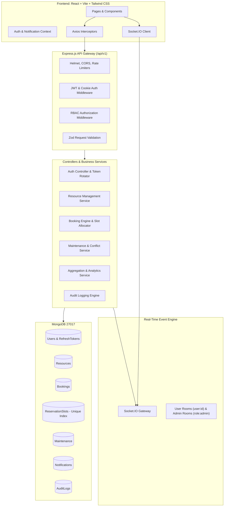

# CampusFlow — Project Implementation Plan
**Smart Campus Resource Booking and Management System**
*Architecture, Specifications, Data Models, Security, and Phased Roadmap*

---

## 1. Executive Summary & Objective

**CampusFlow** is an enterprise-grade, full-stack MERN (MongoDB, Express, React, Node.js) platform designed to eliminate friction, manual logbooks, and scheduling conflicts in modern academic campuses. It centralizes reservations for computer laboratories, science laboratories, seminar halls, smart classrooms, conference suites, projectors, and specialized equipment.

Key engineering pillars:
1. **Race-safe Concurrency**: Discrete time-slot reservations with MongoDB unique compound indexes to mathematically preclude double-booking under concurrent load.
2. **Strict Multi-Role RBAC**: Student, Faculty, and Administrator with authorization enforced on backend middleware and verified at API boundaries.
3. **Real-Time Synchronous & Persistent Notifications**: Socket.IO authenticated user rooms combined with indexed MongoDB notification records.
4. **Resilient Maintenance Engine**: Resource blackouts with conflict detection, user notification dispatch, and slot-level lockouts.
5. **Production Security**: In-memory access tokens, rotating HttpOnly refresh cookies, CSRF header validation, rate-limiting, Helmet headers, and zero plaintext credentials.
6. **Executive Analytics & Audit**: Aggregated real-time metrics, Recharts visual analytics, CSV data exports, and immutable audit logs.

---

## 2. System Architecture

---

## 3. Data Models & Database Design

### 3.1 Collections & Schemas

1. **`User`**
   - `name`: String, required, trim
   - `email`: String, required, unique, lowercase, indexed
   - `password`: String, required (hashed with bcrypt, 12 rounds)
   - `role`: Enum `['student', 'faculty', 'admin']`, default `'student'`
   - `department`: String, required (e.g., Computer Science, Electrical, Mechanical, Physics)
   - `studentOrEmployeeId`: String, optional/required by role
   - `phone`: String, optional
   - `isActive`: Boolean, default `true`
   - `timestamps`: true

2. **`RefreshToken`**
   - `user`: ObjectId -> User, required, indexed
   - `tokenHash`: String, required (SHA-256 hash of random token)
   - `expiresAt`: Date, required, indexed with TTL
   - `isRevoked`: Boolean, default `false`
   - `createdAt`: Date

3. **`PasswordResetToken`**
   - `user`: ObjectId -> User, required
   - `tokenHash`: String, required (SHA-256)
   - `expiresAt`: Date, required, indexed with TTL (1 hour)
   - `isUsed`: Boolean, default `false`

4. **`Resource`**
   - `name`: String, required, trim
   - `code`: String, required, unique, uppercase (e.g., `LAB-CS-101`)
   - `type`: Enum `['computer_lab', 'science_lab', 'seminar_hall', 'classroom', 'conference_room', 'equipment']`
   - `building`: String, required
   - `roomNumber`: String, required
   - `capacity`: Number, required, min: 1
   - `amenities`: [String] (e.g., Projector, Gigabit LAN, AC, Audio System, Smart Board)
   - `operatingHours`: `{ openTime: "08:00", closeTime: "20:00" }`
   - `allowedRoles`: [`student`, `faculty`, `admin`]
   - `minDurationMinutes`: Number, default: 30
   - `maxDurationMinutes`: Number, default: 240
   - `advanceBookingDaysLimit`: Number, default: 14
   - `bufferMinutes`: Number, default: 0
   - `status`: Enum `['active', 'maintenance', 'inactive']`, default `'active'`
   - `imageUrl`: String, optional
   - `description`: String
   - `timestamps`: true

5. **`Booking`**
   - `bookingNumber`: String, unique (e.g., `BK-20261019-XXXX`)
   - `user`: ObjectId -> User, required, indexed
   - `resource`: ObjectId -> Resource, required, indexed
   - `date`: String, format `YYYY-MM-DD`, indexed
   - `startTime`: String, format `HH:mm` (e.g. `09:00`)
   - `endTime`: String, format `HH:mm` (e.g. `11:00`)
   - `startDateTime`: Date, indexed (normalized UTC)
   - `endDateTime`: Date, indexed (normalized UTC)
   - `purpose`: String, required
   - `expectedAttendees`: Number, default: 1
   - `status`: Enum `['pending', 'approved', 'rejected', 'cancelled', 'completed']`, default `'pending'`, indexed
   - `rejectionReason`: String, optional
   - `cancellationReason`: String, optional
   - `reviewedBy`: ObjectId -> User, optional
   - `reviewedAt`: Date, optional
   - `timestamps`: true

6. **`ReservationSlot` (Critical Double-Booking Prevention)**
   - `resource`: ObjectId -> Resource, required
   - `date`: String, format `YYYY-MM-DD`, required
   - `slotTime`: String, format `HH:mm` (discrete 30-min window start, e.g., "09:00", "09:30")
   - `booking`: ObjectId -> Booking, required
   - `status`: Enum `['held', 'confirmed', 'maintenance']`, default `'held'`
   - **Compound Unique Index**: `{ resource: 1, date: 1, slotTime: 1 }` -> **UNIQUE**.

7. **`Maintenance`**
   - `resource`: ObjectId -> Resource, required, indexed
   - `title`: String, required
   - `reason`: String, required
   - `startDate`: String (YYYY-MM-DD)
   - `endDate`: String (YYYY-MM-DD)
   - `startTime`: String (HH:mm)
   - `endTime`: String (HH:mm)
   - `startDateTime`: Date, required
   - `endDateTime`: Date, required
   - `status`: Enum `['scheduled', 'in_progress', 'completed', 'cancelled']`, default `'scheduled'`
   - `createdBy`: ObjectId -> User, required
   - `timestamps`: true

8. **`Notification`**
   - `recipient`: ObjectId -> User, required, indexed
   - `title`: String, required
   - `message`: String, required
   - `type`: Enum `['booking_created', 'booking_approved', 'booking_rejected', 'booking_cancelled', 'maintenance_scheduled', 'system']`
   - `link`: String, optional
   - `isRead`: Boolean, default: false, indexed
   - `readAt`: Date
   - `timestamps`: true

9. **`AuditLog`**
   - `actor`: ObjectId -> User, required, indexed
   - `action`: String, required (e.g., `BOOKING_CREATE`, `BOOKING_APPROVE`, `BOOKING_REJECT`, `BOOKING_CANCEL`, `RESOURCE_CREATE`, `RESOURCE_UPDATE`, `MAINTENANCE_CREATE`, `USER_STATUS_CHANGE`)
   - `targetModel`: String, required
   - `targetId`: String, required
   - `details`: Object (non-sensitive metadata)
   - `ipAddress`: String
   - `createdAt`: Date, default: Date.now, indexed

---

## 4. Concurrency & Race-Safe Reservation Strategy

To prevent race conditions and double bookings under concurrent booking requests:
1. **Time Normalization**: Every booking window `[startTime, endTime]` is expanded into discrete 30-minute slot slices (e.g. `09:00 - 10:30` -> `["09:00", "09:30", "10:00"]`).
2. **Atomic Collision Handling via MongoDB Unique Indexes**:
   - The collection `ReservationSlot` enforces `{ resource: 1, date: 1, slotTime: 1 }` with `{ unique: true }`.
   - When a booking request arrives, the server creates the `Booking` record in status `pending` (or `approved` if automatic) and immediately attempts to insert the slice of `ReservationSlot` documents.
   - If ANY slot within the interval is already occupied, MongoDB rejects the insert with duplicate key error `E11000`.
   - The engine catches code 11000, rolls back the unconfirmed booking, and returns `409 Conflict: One or more requested time slots are already booked`.
   - On booking rejection or cancellation: `ReservationSlot.deleteMany({ booking: bookingId })` atomically frees all occupied slots.
   - On maintenance lockout: maintenance slots are registered in `ReservationSlot` with status `'maintenance'`, disallowing all regular bookings.

---

## 5. Security & Session Architecture

1. **Authentication Tokens**:
   - Short-lived Access Token: Signed JWT, expires in 15 minutes, returned in JSON payload and kept in application memory.
   - Rotating Refresh Token: Cryptographically secure random hex string, hashed with SHA-256 before storage in MongoDB `RefreshToken` collection with 7-day expiration.
   - Refresh Cookie: Sent via `Set-Cookie` with flags `HttpOnly; Path=/api/v1/auth; SameSite=Lax` (and `Secure` in production).
2. **CSRF Protection**:
   - State-changing API calls require custom header `X-Requested-With: XMLHttpRequest` which cannot be set cross-origin via simple HTML forms or scripts without explicit CORS preflight acceptance.
3. **Password Security**:
   - bcrypt with cost factor 12. Password complexity validation: min 8 characters, at least 1 uppercase, 1 lowercase, 1 digit, 1 special character.
4. **Rate Limiting**:
   - Strict rate limiting on `/api/v1/auth/login` (5 requests / 15 min per IP), `/signup`, and `/forgot-password`.
5. **Role-Based Authorization**:
   - Middleware `authenticate` verifies access token or refreshes transparently.
   - Middleware `authorize(...roles)` blocks unauthorized access with `403 Forbidden` and audits suspicious attempts.
6. **Input Validation**:
   - Strict Zod schemas on every request payload (body, query, params) before controller execution.

---

## 6. REST API Design (`/api/v1`)

| Module | Method | Endpoint | Access | Purpose |
|---|---|---|---|---|
| **Auth** | POST | `/auth/signup` | Public | Register student/faculty account |
| | POST | `/auth/login` | Public | Authenticate user, issue tokens |
| | POST | `/auth/refresh` | Public (Cookie) | Rotate refresh token, issue access token |
| | POST | `/auth/logout` | Authenticated | Revoke refresh token, clear cookie |
| | GET | `/auth/me` | Authenticated | Fetch current user session profile |
| | POST | `/auth/forgot-password` | Public | Request password reset token |
| | POST | `/auth/reset-password` | Public | Submit new password with reset token |
| **Resources** | GET | `/resources` | Public | List & filter resources (pagination, search) |
| | GET | `/resources/:id` | Public | Get single resource details & rules |
| | GET | `/resources/:id/availability` | Public | Check available slots for a specific date |
| | POST | `/resources` | Admin | Create a new campus resource |
| | PUT | `/resources/:id` | Admin | Update resource specifications |
| | DELETE | `/resources/:id` | Admin | Archive/deactivate resource |
| **Bookings** | POST | `/bookings` | Student, Faculty, Admin | Submit booking request |
| | GET | `/bookings/my` | Authenticated | List requester's personal bookings |
| | GET | `/bookings/:id` | Authenticated | Get booking details & status |
| | PATCH | `/bookings/:id/cancel` | Authenticated | Cancel booking (requester or admin) |
| | GET | `/bookings/admin/queue` | Admin | Pending bookings queue with conflict alert |
| | PATCH | `/bookings/:id/approve` | Admin | Approve pending booking request |
| | PATCH | `/bookings/:id/reject` | Admin | Reject pending booking request with reason |
| **Maintenance**| GET | `/maintenance` | Admin | List all scheduled maintenance blocks |
| | POST | `/maintenance` | Admin | Schedule resource maintenance & handle conflicts |
| | PATCH | `/maintenance/:id/cancel`| Admin | Cancel maintenance block |
| **Notifications**| GET | `/notifications` | Authenticated | Get notifications (unread first) |
| | PATCH | `/notifications/:id/read` | Authenticated | Mark notification as read |
| | PATCH | `/notifications/read-all` | Authenticated | Mark all notifications as read |
| **Analytics & Reports** | GET | `/analytics/dashboard` | Admin | Summary statistics & utilization rates |
| | GET | `/analytics/export/bookings` | Admin | Export filtered bookings to CSV |
| | GET | `/analytics/export/utilization` | Admin | Export resource utilization summary to CSV |
| **Users** | GET | `/users` | Admin | List users with pagination and search |
| | PATCH | `/users/:id/role` | Admin | Change user role |
| | PATCH | `/users/:id/status` | Admin | Activate or suspend user account |
| **Audit** | GET | `/audit-logs` | Admin | Retrieve system audit logs with filters |
| **Health** | GET | `/health` | Public | Readiness & liveness probe |

---

## 7. Frontend Architecture & Design System

### 7.1 Visual System
- **Colors**:
  - Primary Dark: Deep Navy (`#0B1220`)
  - Accent Blue: Royal Blue (`#2563EB`), Hover (`#1D4ED8`)
  - Background Neutral: Light Slate (`#F8FAFC`), Cards (`#FFFFFF`)
  - Borders: Slate 200 (`#E2E8F0`)
  - Semantic: Success (`#10B981`), Warning (`#F59E0B`), Danger (`#EF4444`)
- **Typography**: Inter / Outfit sans-serif hierarchy with crisp weights.
- **Icons**: Lucide React for consistent modern stroke iconography.

### 7.2 Route Hierarchy
- Public:
  - `/` -> Landing Page (Hero, Features, Live Resource Discovery, Demo Showcase)
  - `/resources` -> Resource Catalog with Search, Filters (Type, Capacity, Amenities)
  - `/resources/:id` -> Resource Detail View with Schedule Visualizer
  - `/login` -> User Sign In
  - `/signup` -> Account Registration
  - `/forgot-password` -> Request Reset Link
  - `/reset-password` -> Password Reset Execution
- Authenticated (Student / Faculty):
  - `/student/dashboard` or `/faculty/dashboard` -> Personalized overview
  - `/bookings` -> My Bookings History & Active Reservations
  - `/bookings/:id` -> Single Booking Tracker with Status Badges
  - `/notifications` -> Notifications Center
- Administrator:
  - `/admin/dashboard` -> Real-time KPIs & Utilization Charts
  - `/admin/resources` -> Resource Inventory CRUD & Configuration
  - `/admin/bookings` -> Approvals Queue & Global Reservations Management
  - `/admin/maintenance` -> Maintenance Scheduler & Conflict Monitor
  - `/admin/users` -> User Management & Role Promotion
  - `/admin/audit-logs` -> Security Audit Trail
  - `/admin/reports` -> CSV Report Generator

---

## 8. Implementation Phases

- **Phase 1: Project Setup & Core Plumbing**
  - Root configuration, package.json monorepo structure.
  - Server initialization (Express, Mongoose, Socket.IO, security middleware, environment loaders).
  - Client initialization (Vite, React, Tailwind CSS, Lucide React, Axios, React Router).
- **Phase 2: Database Models & Concurrency Engine**
  - Mongoose models with indexes and validation.
  - Concurrency slot allocator with atomic unique index collision handling.
- **Phase 3: Authentication & RBAC Engine**
  - Signup, login, refresh rotation, logout, reset-password tokens.
  - Access control middleware and client auth context with auto-refresh.
- **Phase 4: Resource Management & Availability API**
  - Resource CRUD, filters, operating hours, role rules, real-time availability endpoint.
- **Phase 5: Booking Engine & Approval Workflows**
  - Booking request pipeline, slot holding, admin queue, approval/rejection with conflict revalidation.
- **Phase 6: Maintenance Engine & Automatic Conflict Resolution**
  - Maintenance schedule, conflict detection, user notification, slot locking.
- **Phase 7: Real-Time Notifications & Socket.IO Integration**
  - Authenticated user socket rooms, event emissions, persistent notifications.
- **Phase 8: Dashboards, Analytics & CSV Reports**
  - Recharts analytics, department metrics, utilization rates, CSV exports, audit logging.
- **Phase 9: Comprehensive UI/UX Polishing**
  - Full modern responsive layouts, landing page, interactive calendar/slot picker, modals, toasts, skeleton states.
- **Phase 10: Seed Data & Testing Suite**
  - Idempotent seed script with realistic campus resources.
  - CLI admin provisioning command.
  - Automated tests (API tests with Supertest, frontend tests with Vitest).
- **Phase 11: Verification, Documentation & Final Audit**
  - End-to-end testing, production builds, comprehensive architecture & API documentation, training report outline.

---

## 9. Acceptance Criteria

1. [x] Zero hardcoded secrets; validated configuration with fallback.
2. [x] Dual-token authentication with rotating refresh token and secure cookies.
3. [x] Race-safe double-booking prevention tested under concurrent API requests.
4. [x] Full resource lifecycle (creation, hours, role restrictions, availability check).
5. [x] Full booking lifecycle (pending -> approved/rejected/cancelled) with live socket alerts.
6. [x] Maintenance periods preemptively block slots and notify affected users.
7. [x] Clean admin dashboard with Recharts visualizations and CSV exports.
8. [x] Complete documentation: Architecture, Database Schema, API Docs, Testing Guide, Training Report.
9. [x] Frontend builds cleanly with zero errors; backend passes all automated tests.
