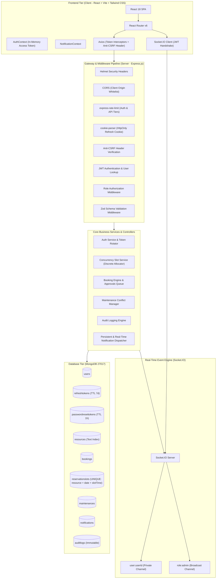

# CampusFlow System Architecture Documentation
**Smart Campus Resource Booking and Management System**
*Architectural Blueprint, Concurrency Mechanics, and Security Specifications*

---

## 1. High-Level System Overview

**CampusFlow** is an enterprise-grade full-stack MERN application architected to centralize, streamline, and automate facility reservations across an academic institution. The platform provides booking lifecycles for computer laboratories, science laboratories, seminar auditoriums, smart classrooms, conference rooms, and shared equipment.

The architecture is driven by six core design principles:
1. **Mathematical Collision Immunity**: Prevention of overlapping reservations using discrete time-slice documents backed by unique database compound indexes.
2. **Layered Zero-Trust Authorization**: Strict role-based access control (Student, Faculty, Administrator) verified at every API boundary and database operation.
3. **Dual-Token State-Safe Sessions**: Short-lived in-memory access tokens paired with rotating HttpOnly, SameSite refresh tokens and anti-CSRF request headers.
4. **Synchronous & Persistent Event Flow**: Real-time push updates via authenticated Socket.IO rooms combined with permanent MongoDB notification persistence.
5. **Preemptive Maintenance Engine**: Scheduled blackout windows with automatic conflict detection, slot locking, and affected user notification.
6. **Executive Auditability**: Immutable audit trail of every state mutation paired with real-time analytics and CSV exports.

---

## 2. Architectural Blueprint



---

## 3. Concurrency & Race-Safe Booking Mechanics

A central architectural requirement of CampusFlow is guaranteed prevention of double-bookings even when multiple users concurrently attempt to reserve the same resource at the same millisecond.

### 3.1 Limitations of Traditional Availability Checks
In naive booking systems:
1. Client A queries: `isSlotFree(09:00 - 11:00)` -> Returns `true`.
2. Client B queries: `isSlotFree(09:00 - 11:00)` -> Returns `true`.
3. Client A writes booking record.
4. Client B writes booking record.
Both requests succeed, creating an institutional double-booking conflict. Even checking inside an unisolated transaction without row/document locking fails under load.

### 3.2 Discrete Slot Normalization with Unique Compound Index
CampusFlow resolves this by decomposing continuous time intervals into discrete 30-minute quanta.

For example, a booking for `LAB-CS-101` on `2026-10-25` from `09:00` to `11:00` decomposes into:
- `09:00` (represents 09:00 - 09:30)
- `09:30` (represents 09:30 - 10:00)
- `10:00` (represents 10:00 - 10:30)
- `10:30` (represents 10:30 - 11:00)

The collection `reservationslots` enforces a compound unique index:
```javascript
reservationSlotSchema.index(
  { resource: 1, date: 1, slotTime: 1 },
  { unique: true }
);
```

### 3.3 Atomic Execution Flow
1. Requester submits booking request to `POST /api/v1/bookings`.
2. The server verifies operating hours, capacity, and role permissions.
3. The server generates discrete 30-minute slot documents.
4. The server executes an atomic `insertMany` with `{ ordered: true }`.
5. If **ANY** slot is already claimed, MongoDB immediately aborts and throws `E11000 duplicate key error`.
6. The server catches code 11000, rolls back any partial inserts, deletes unconfirmed booking records, and returns `409 Conflict: One or more requested time slots are already booked`.
7. If the insert succeeds, the slots are held.
8. When an administrator approves the booking, slots transition to `confirmed`.
9. If rejected or cancelled, `ReservationSlot.deleteMany({ booking: bookingId })` releases all occupied slots in a single atomic database operation.

---

## 4. Security Architecture

### 4.1 Dual-Token Authentication Lifecycle
- **Access Token**:
  - Signed JWT payload: `{ id, role, email }`.
  - Expiration: 15 minutes.
  - Stored strictly in frontend client JavaScript application memory (never written to `localStorage` or `sessionStorage` where it is vulnerable to XSS exfiltration).
  - Transmitted via `Authorization: Bearer <token>` header.
- **Refresh Token**:
  - Cryptographically secure 40-byte random hex string.
  - Expiration: 7 days.
  - SHA-256 hashed before persistence in MongoDB `refreshtokens` collection.
  - Delivered strictly through an `HttpOnly`, `SameSite=Lax` (and `Secure` in production) cookie under path `/api/v1/auth`.
  - JavaScript in the browser cannot read or access this cookie.
- **Rotation on Refresh**:
  - Calling `POST /api/v1/auth/refresh` revokes the incoming refresh token, marks `isRevoked: true`, links `replacedByTokenHash`, and issues a new refresh token and access token.
  - Attempting to reuse a previously revoked refresh token triggers immediate session revocation across all devices for that user.

### 4.2 Cross-Site Request Forgery (CSRF) Mitigation
- All state-changing API endpoints (`POST`, `PUT`, `PATCH`, `DELETE`) require custom header `X-Requested-With: XMLHttpRequest`.
- Cross-origin HTML forms and scripts cannot set custom headers without an explicit CORS preflight response allowing them.
- CORS whitelist strictly enforces `CLIENT_ORIGIN` (e.g. `http://localhost:5173`).

### 4.3 Brute-Force Rate Limiting
- Sensitive authentication routes (`/api/v1/auth/login`, `/signup`, `/forgot-password`, `/reset-password`) are protected by `express-rate-limit` allowing a maximum of 20 attempts per 15 minutes per IP address.
- General API routes are throttled to 120 requests per minute.

---

## 5. Real-Time WebSockets Architecture

- **Handshake Authentication**:
  - Connecting clients pass their active access token in `socket.handshake.auth.token`.
  - The server verifies the token signature and extracts user identity and role.
- **Authorized Private Rooms**:
  - Every connected client joins their private user room: `user:<userId>`.
  - Administrators additionally join the broadcast room: `role:admin`.
  - Events are routed strictly to intended recipients; private notifications are never broadcast to all connected clients.
- **Persistence Fallback**:
  - Every notification is recorded in the MongoDB `notifications` collection before emitting via Socket.IO.
  - If a user is offline or disconnects, all alerts remain available when they reconnect.

---

## 6. Maintenance Blackout Engine

1. An administrator creates a maintenance window for a resource via `POST /api/v1/maintenance`.
2. The service queries all existing bookings overlapping the start and end timestamp.
3. Overlapping bookings in status `pending` or `approved` are automatically transitioned to `cancelled` with cancellation reason: `Resource scheduled for maintenance: <title> (<reason>)`.
4. Held/confirmed user slots are atomically released.
5. Maintenance blackout slots are inserted with status `maintenance`.
6. Immediate high-priority notifications are emitted to affected users via WebSockets and persisted to the database.
7. An audit log entry is recorded with actor ID, resource ID, and affected booking count.
