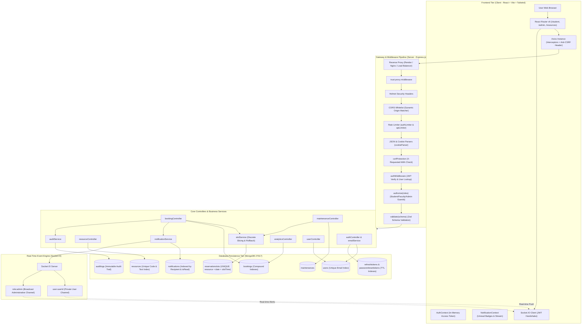
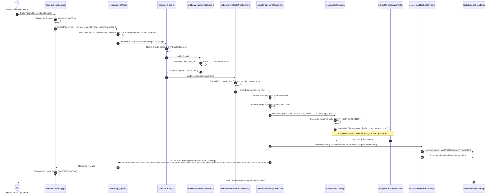

# CampusFlow — System Architecture & Request Lifecycle

## 1. High-Level Architectural Blueprint

CampusFlow is designed as a modular 3-tier system consisting of a client presentation layer, a gateway and application service layer, and a document database persistence layer, augmented by a real-time event pipeline:



---

## 2. Step-by-Step Request Lifecycle: A Real Concrete Example

To understand how code moves across the architecture, follow this exact real-world scenario from the codebase:

**Scenario**: Student **Manan Sharma** reserves the **Alan Turing Advanced Computing Lab (`LAB-CS-101`)** on **October 30, 2026**, from **10:00 to 12:00**.



### The 12 Stages Explained:

1. **User Interaction**: The student clicks the "Submit Reservation Request" button on `ResourceDetailPage.jsx`.
2. **React Form Handling & Validation**: `handleBookingSubmit()` in `ResourceDetailPage.jsx` checks that `startTime` is strictly before `endTime`, ensures required fields are filled, and prevents double submissions by setting `bookingSubmitting = true`.
3. **HTTP Client Interceptor**: `frontend/src/services/api.js` intercepts the outgoing request:
   - Injects the in-memory access token into `headers.Authorization = "Bearer <token>"`.
   - Injects `X-Requested-With = "XMLHttpRequest"` for anti-CSRF protection.
4. **Network & Express Gateway**: The request reaches `backend/src/server.js` and passes into `backend/src/app.js`:
   - `helmet` applies defensive HTTP headers.
   - `cors` verifies that the origin is allowed.
   - `express.json()` parses the request body into `req.body`.
5. **Rate Limiting**: `apiLimiter` checks that the client IP has not exceeded 120 requests in the current 60-second window.
6. **Authentication & Identity Verification**: `backend/src/middleware/authMiddleware.js` extracts the bearer token, verifies its cryptographic signature using `JWT_ACCESS_SECRET`, queries `User.findById(decoded.id)`, verifies `user.isActive === true`, and binds the full user document to `req.user`.
7. **Schema Validation**: `backend/src/middleware/validateMiddleware.js` invokes `createBookingSchema` from `bookingValidators.js`. Zod verifies that `date` is valid, `startTime` and `endTime` conform to `/^([01]\d|2[0-3]):[0-5]\d$/`, and `purpose` is at least 5 characters.
8. **Controller Business Rule Evaluation**: `createBooking` in `bookingController.js`:
   - Verifies the resource exists and is in `active` status.
   - Verifies that the user's role is in `resource.allowedRoles`.
   - Verifies that attendee count does not exceed `resource.capacity`.
   - Calculates time in minutes via `timeUtils.js` and verifies the duration falls within `minDurationMinutes` and `maxDurationMinutes`.
   - Verifies the booking date does not exceed `advanceBookingDaysLimit`.
9. **Atomic Discrete Slot Reservation**: The controller invokes `reserveSlots()` in `slotService.js`:
   - Decomposes `10:00 - 12:00` into discrete 30-minute intervals: `["10:00", "10:30", "11:00", "11:30"]`.
   - Prepares 4 documents for the `reservationslots` collection.
   - Executes `ReservationSlot.insertMany(docs, { ordered: true })`.
   - If any slot is already reserved, MongoDB immediately throws an `E11000 duplicate key error` on the unique compound index (`resource + date + slotTime`). The service catches this error, deletes any partial inserts, and throws a structured `409 Conflict` error.
10. **Audit Logging & Notifications**:
    - An immutable audit log entry is written by `recordAuditLog()` in `auditService.js`.
    - `sendNotification()` in `notificationService.js` creates a persistent notification record in MongoDB and pushes the event to the user's private Socket.IO room (`user:<userId>`).
    - `notifyAdmins()` broadcasts an alert to `role:admin`.
11. **JSON Envelope Response**: The controller responds with HTTP `201 Created` returning the populated booking document.
12. **Frontend UI State Mutation**: React receives the response in `ResourceDetailPage.jsx`, sets `successModalOpen = true`, triggers a toast notification via `ToastContext`, and refreshes the real-time slot availability grid.

---

## 3. Real-Time WebSocket Architecture

CampusFlow uses **Socket.IO** to maintain a persistent connection between clients and the server:

```
[Student Browser]  <=== Authenticated WebSocket ===>  [Socket.IO Server]  <=== Authenticated WebSocket ===>  [Admin Browser]
Joined: "user:studentId"                                                             Joined: "user:adminId", "role:admin"
```

1. **Authentication Handshake**: In `backend/src/sockets/socketHandler.js`, a Socket.IO middleware authenticates every connection:
   ```javascript
   const token = socket.handshake.auth?.token || socket.handshake.headers?.authorization;
   const decoded = jwt.verify(token, config.jwt.accessSecret);
   socket.user = { id: decoded.id, role: decoded.role };
   ```
2. **Channel Isolation**:
   - Every user joins their private room: `socket.join('user:' + socket.user.id)`.
   - Administrative users also join the administrative channel: `socket.join('role:admin')`.
3. **Targeted Emission**: When an event occurs, the server emits specifically to the target room:
   ```javascript
   io.to(`user:${recipient}`).emit('notification:new', notification);
   io.to('role:admin').emit('admin:alert', alertPayload);
   ```
   This guarantees that sensitive approval alerts and personal booking updates are never leaked to unauthorized users.
