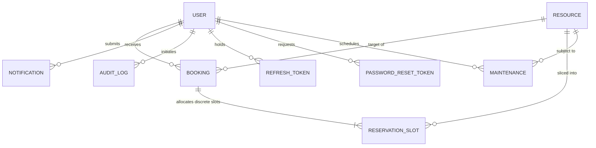

# CampusFlow — Database Architecture & Data Modeling

## 1. Entity-Relationship Overview

CampusFlow uses **MongoDB** as a document database and **Mongoose** as its Object Data Modeling (ODM) layer. Unlike a traditional SQL database that uses tables and foreign key constraints, MongoDB stores rich BSON documents with embedded sub-documents and relational references (`ObjectId`).



---

## 2. Model-by-Model Specifications

### 2.1 `User` (`backend/src/models/User.js`)
Stores all registered academic staff, students, and system administrators.

| Field | Type | Required | Default | Validation & Constraints | Description |
|---|---|---|---|---|---|
| `_id` | `ObjectId` | Auto | Generated | Unique identifier | Primary Key |
| `name` | `String` | Yes | None | `minlength: 2`, `maxlength: 100`, trimmed | Full legal name |
| `email` | `String` | Yes | None | Unique, lowercase, regex: `/^\S+@\S+\.\S+$/` | University email |
| `password` | `String` | Yes | None | `minlength: 8`, `select: false` (hidden by default) | bcrypt hash (12 rounds) |
| `role` | `String` | Yes | `'student'` | Enum: `['student', 'faculty', 'admin']` | Privilege tier |
| `department`| `String` | Yes | None | Trimmed | Academic/admin department |
| `studentOrEmployeeId` | `String` | No | `''` | Trimmed | Campus roll/employee ID |
| `phone` | `String` | No | `''` | Trimmed | Contact telephone |
| `isActive` | `Boolean` | Yes | `true` | Indexed | Account suspension flag |
| `createdAt`| `Date` | Auto | Generated | ISO 8601 timestamp | Account creation date |
| `updatedAt`| `Date` | Auto | Generated | ISO 8601 timestamp | Profile update date |

**Indexes**:
- `{ email: 1 }` (Unique)
- `{ role: 1 }`
- `{ isActive: 1 }`

**Fictional Sample Document**:
```json
{
  "_id": "672000000000000000000001",
  "name": "Manan Sharma",
  "email": "student.manan@campusflow.edu",
  "role": "student",
  "department": "Computer Science & Engineering",
  "studentOrEmployeeId": "STU-2026-891",
  "phone": "+1 (555) 019-9944",
  "isActive": true,
  "createdAt": "2026-10-28T12:00:00.000Z",
  "updatedAt": "2026-10-28T12:00:00.000Z"
}
```

---

### 2.2 `Resource` (`backend/src/models/Resource.js`)
Defines physical campus rooms, computing laboratories, lecture halls, and shared apparatus.

| Field | Type | Required | Default | Validation & Constraints | Description |
|---|---|---|---|---|---|
| `name` | `String` | Yes | None | Trimmed, indexed | Facility display name |
| `code` | `String` | Yes | None | Unique, uppercase, trimmed | Facility code (e.g. `LAB-CS-101`) |
| `type` | `String` | Yes | None | Enum: `['computer_lab', 'science_lab', 'seminar_hall', 'classroom', 'conference_room', 'equipment']` | Category |
| `building` | `String` | Yes | None | Trimmed, indexed | Campus building name |
| `roomNumber` | `String` | Yes | None | Trimmed | Physical room or asset locker |
| `capacity` | `Number` | Yes | None | `min: 1` | Maximum allowable attendees |
| `amenities` | `[String]`| No | `[]` | Array of strings | Equipment & feature tags |
| `operatingHours.openTime` | `String` | No | `'08:00'` | Regex: `/^([01]\d|2[0-3]):[0-5]\d$/` | Daily open time |
| `operatingHours.closeTime` | `String` | No | `'20:00'` | Regex: `/^([01]\d|2[0-3]):[0-5]\d$/` | Daily close time |
| `allowedRoles` | `[String]` | No | `['student', 'faculty', 'admin']` | Subset of ROLES enum | Permitted booking roles |
| `minDurationMinutes` | `Number` | No | `30` | `min: 15` | Minimum booking duration |
| `maxDurationMinutes` | `Number` | No | `240` | `max: 720` (12 hours) | Maximum booking duration |
| `advanceBookingDaysLimit`| `Number` | No | `14` | `min: 1` | Max days in advance to book |
| `status` | `String` | Yes | `'active'` | Enum: `['active', 'maintenance', 'inactive']` | Availability state |
| `imageUrl` | `String` | No | `''` | URL string | Photograph/preview image |
| `description` | `String` | No | `''` | Trimmed | Detailed markdown description |

**Indexes**:
- `{ code: 1 }` (Unique)
- `{ name: 1 }`, `{ building: 1 }`, `{ type: 1 }`, `{ status: 1 }`
- Text Index: `{ name: "text", description: "text", building: "text", code: "text" }` (Powers free-text search)

**Fictional Sample Document**:
```json
{
  "_id": "672000000000000000000010",
  "name": "Alan Turing Advanced Computing Lab",
  "code": "LAB-CS-101",
  "type": "computer_lab",
  "building": "Turing Technology Complex",
  "roomNumber": "Room 101",
  "capacity": 60,
  "amenities": ["Gigabit Fiber LAN", "60x RTX 4080 Workstations", "Dual 4K Projectors", "Air Conditioning"],
  "operatingHours": { "openTime": "08:00", "closeTime": "20:00" },
  "allowedRoles": ["student", "faculty", "admin"],
  "minDurationMinutes": 30,
  "maxDurationMinutes": 240,
  "advanceBookingDaysLimit": 14,
  "status": "active",
  "imageUrl": "https://images.unsplash.com/photo-1517694712202-14dd9538aa97",
  "description": "Premier computing facility equipped for distributed systems and AI research practicals."
}
```

---

### 2.3 `Booking` (`backend/src/models/Booking.js`)
Represents an individual reservation request submitted by an authenticated user.

| Field | Type | Required | Default | Constraints & Description |
|---|---|---|---|---|
| `bookingNumber` | `String` | Yes | Generated | Unique human-readable code: `BK-YYYYMMDD-HEX` |
| `user` | `ObjectId` | Yes | None | Reference to `User` |
| `resource` | `ObjectId` | Yes | None | Reference to `Resource` |
| `date` | `String` | Yes | None | Calendar date string: `YYYY-MM-DD` |
| `startTime` | `String` | Yes | None | Starting time: `HH:mm` |
| `endTime` | `String` | Yes | None | Ending time: `HH:mm` |
| `startDateTime` | `Date` | Yes | None | UTC Normalized Start Timestamp (for range queries) |
| `endDateTime` | `Date` | Yes | None | UTC Normalized End Timestamp (for range queries) |
| `purpose` | `String` | Yes | None | Max 500 characters describing usage reason |
| `expectedAttendees` | `Number` | No | `1` | Must not exceed `resource.capacity` |
| `status` | `String` | Yes | `'pending'` | Enum: `['pending', 'approved', 'rejected', 'cancelled', 'completed']` |
| `rejectionReason` | `String` | No | `''` | Explanation recorded when administrator rejects |
| `cancellationReason`| `String`| No | `''` | Explanation recorded when user/admin cancels |
| `reviewedBy` | `ObjectId` | No | `null` | Reference to `User` (Administrator who approved/rejected) |
| `reviewedAt` | `Date` | No | `null` | Timestamp of administrative review |

**Compound Indexes**:
- `{ resource: 1, date: 1, status: 1 }` (Accelerates conflict and availability queries)
- `{ user: 1, status: 1, createdAt: -1 }` (Accelerates student "My Bookings" list)

---

### 2.4 `ReservationSlot` (`backend/src/models/ReservationSlot.js`) — Concurrency Engine
The core database collection guaranteeing mathematical prevention of double-bookings.

| Field | Type | Required | Default | Description |
|---|---|---|---|---|
| `resource` | `ObjectId` | Yes | None | Reference to `Resource` |
| `date` | `String` | Yes | None | Calendar date: `YYYY-MM-DD` |
| `slotTime` | `String` | Yes | None | Discrete 30-minute block: `HH:mm` (e.g. `'10:00'`) |
| `booking` | `ObjectId` | Yes | None | Reference to associated `Booking` or `Maintenance` |
| `status` | `String` | Yes | `'held'` | Enum: `['held', 'confirmed', 'maintenance']` |

**CRITICAL UNIQUE COMPOUND INDEX**:
```javascript
reservationSlotSchema.index({ resource: 1, date: 1, slotTime: 1 }, { unique: true });
```
- **How it Works**: If a user attempts to book `10:00 - 11:30`, the system generates three slot documents: `10:00`, `10:30`, and `11:00`. If any other user attempts to reserve `10:30 - 12:00` for the same facility on the same date, the database **rejects the insert** with an `E11000 duplicate key error` on the index.

---

### 2.5 `Maintenance` (`backend/src/models/Maintenance.js`)
Tracks scheduled facility shutdowns, repairs, and cleanings.

| Field | Type | Required | Description |
|---|---|---|---|
| `resource` | `ObjectId` | Yes | Reference to affected `Resource` |
| `title` | `String` | Yes | Short title (e.g. "HVAC Filter Replacement") |
| `reason` | `String` | Yes | Detailed operational explanation |
| `startDate`, `endDate` | `String` | Yes | `YYYY-MM-DD` |
| `startTime`, `endTime` | `String` | Yes | `HH:mm` |
| `startDateTime`, `endDateTime` | `Date` | Yes | Timestamps for range intersection queries |
| `status` | `String` | Yes | Enum: `['scheduled', 'in_progress', 'completed', 'cancelled']` |
| `affectedBookingsCount` | `Number` | Yes | Number of user reservations auto-cancelled |
| `createdBy` | `ObjectId` | Yes | Administrator who scheduled the blackout |

---

### 2.6 `Notification` (`backend/src/models/Notification.js`)
Stores persistent user alerts across the application lifecycle.

| Field | Type | Required | Default | Description |
|---|---|---|---|---|
| `recipient` | `ObjectId` | Yes | None | Reference to target `User` |
| `title` | `String` | Yes | None | Short header text (e.g. "Booking Approved! 🎉") |
| `message` | `String` | Yes | None | Body text with facility and date details |
| `type` | `String` | Yes | `'system'` | Enum: `booking_created`, `booking_approved`, `booking_rejected`, `booking_cancelled`, `maintenance_scheduled`, `system` |
| `link` | `String` | No | `''` | Deep link route in the React frontend (e.g. `/bookings/67...`) |
| `isRead` | `Boolean` | Yes | `false` | Read status |
| `readAt` | `Date` | No | `null` | Timestamp when user opened notification |
| `metadata` | `Mixed` | No | `{}` | Flexible payload storing booking IDs or reasons |

**Index**:
- `{ recipient: 1, isRead: 1, createdAt: -1 }` (Powers unread badge count queries)

---

### 2.7 `AuditLog` (`backend/src/models/AuditLog.js`)
An immutable, append-only security log of institutional decisions.

| Field | Type | Required | Description |
|---|---|---|---|
| `actor` | `ObjectId` | Yes | Reference to `User` who performed the action |
| `action` | `String` | Yes | Enum from `AUDIT_ACTIONS` (e.g. `BOOKING_APPROVE`, `USER_ROLE_CHANGE`) |
| `targetModel` | `String` | Yes | Target collection name (e.g. `'Booking'`, `'Resource'`, `'User'`) |
| `targetId` | `String` | Yes | ID string of the modified entity |
| `details` | `Mixed` | No | Sanitized JSON metadata (secrets, passwords, and tokens stripped) |
| `ipAddress` | `String` | No | Client IP address |
| `userAgent` | `String` | No | Browser/platform User-Agent string |
| `createdAt` | `Date` | Auto | Creation timestamp (`updatedAt` is disabled to enforce immutability) |

---

### 2.8 `RefreshToken` & `PasswordResetToken`
Session security collections backed by **MongoDB Automatic TTL (Time-to-Live) Indexes**:

- `RefreshToken` (`backend/src/models/RefreshToken.js`):
  - Stores SHA-256 hashes of rotating refresh tokens.
  - Index: `{ expiresAt: 1 }` with `{ expires: '7d' }`. MongoDB's background thread automatically sweeps and purges expired session records after 7 days without requiring manual cleanup jobs.
- `PasswordResetToken` (`backend/src/models/PasswordResetToken.js`):
  - Stores single-use reset tokens.
  - Index: `{ expiresAt: 1 }` with `{ expires: '1h' }`. Automatically deleted after 1 hour.
