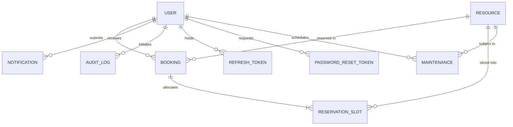

# CampusFlow Database Schema Specification
**MongoDB Document Modeling, Indexes, and Relational Constraints**

---

## 1. Entity Relationship Overview



---

## 2. Collections & Field Specifications

### 2.1 `users`
Represents registered students, faculty members, and campus system administrators.

| Field | Type | Validation & Constraints | Description |
|---|---|---|---|
| `_id` | ObjectId | Primary Key | Unique document identifier |
| `name` | String | Required, trim, min: 2, max: 100 | Full legal name |
| `email` | String | Required, unique, lowercase, regex email | University email address |
| `password` | String | Required, min: 8, select: false | bcrypt hash (12 salt rounds) |
| `role` | String | Enum: `['student', 'faculty', 'admin']`, default: `'student'` | Access privilege tier |
| `department` | String | Required, trim | Academic or administrative division |
| `studentOrEmployeeId`| String | Optional, trim | Institutional ID number |
| `phone` | String | Optional, trim | Contact telephone number |
| `isActive` | Boolean | Default: `true` | Account suspension status |
| `createdAt` | Date | Automatic timestamp | Account creation timestamp |
| `updatedAt` | Date | Automatic timestamp | Last profile update timestamp |

**Indexes**:
- `{ email: 1 }` (Unique)
- `{ role: 1 }`
- `{ isActive: 1 }`

---

### 2.2 `refreshtokens`
Stores server-side cryptographic hashes of rotating refresh tokens for secure session maintenance.

| Field | Type | Validation & Constraints | Description |
|---|---|---|---|
| `_id` | ObjectId | Primary Key | Document identifier |
| `user` | ObjectId | Ref: `User`, Required, indexed | Reference to authenticated user |
| `tokenHash` | String | Required, indexed | SHA-256 hash of refresh token |
| `expiresAt` | Date | Required, TTL: 7 days | Absolute session expiration |
| `isRevoked` | Boolean | Default: `false` | Revocation status on rotation or logout |
| `replacedByTokenHash`| String| Default: `null` | Audit chain for token reuse detection |
| `ipAddress` | String | Optional | Client IP address at issuance |
| `userAgent` | String | Optional | Client User-Agent string |
| `createdAt` | Date | Automatic timestamp | Token generation timestamp |

**Indexes**:
- `{ tokenHash: 1 }`
- `{ user: 1 }`
- `{ expiresAt: 1 }` (TTL: `expireAfterSeconds: 0`)

---

### 2.3 `passwordresettokens`
Stores single-use SHA-256 hashed password reset tokens with 1-hour automatic expiration.

| Field | Type | Validation & Constraints | Description |
|---|---|---|---|
| `_id` | ObjectId | Primary Key | Document identifier |
| `user` | ObjectId | Ref: `User`, Required, indexed | User requesting password reset |
| `tokenHash` | String | Required, indexed | SHA-256 hash of random reset token |
| `expiresAt` | Date | Required, TTL: 1 hour | Time-to-live expiration timestamp |
| `isUsed` | Boolean | Default: `false` | Single-use invalidation flag |

---

### 2.4 `resources`
Defines campus physical rooms, computing clusters, lecture halls, and portable laboratory equipment.

| Field | Type | Validation & Constraints | Description |
|---|---|---|---|
| `_id` | ObjectId | Primary Key | Document identifier |
| `name` | String | Required, trim, indexed | Display name (e.g. Alan Turing Computing Lab) |
| `code` | String | Required, unique, uppercase, trim | Unique facility identifier (e.g. `LAB-CS-101`) |
| `type` | String | Enum: `['computer_lab', 'science_lab', 'seminar_hall', 'classroom', 'conference_room', 'equipment']` | Facility categorization |
| `building` | String | Required, trim, indexed | Campus building name |
| `roomNumber` | String | Required, trim | Physical room number or depot location |
| `capacity` | Number | Required, min: 1 | Maximum allowable headcount |
| `amenities` | [String] | Array of strings | Installed equipment, network, and AV specs |
| `operatingHours` | Object | `{ openTime: "08:00", closeTime: "20:00" }` | Daily allowable booking window |
| `allowedRoles` | [String] | Enum: `['student', 'faculty', 'admin']` | RBAC booking eligibility |
| `minDurationMinutes`| Number | Min: 15, default: 30 | Minimum booking length |
| `maxDurationMinutes`| Number | Max: 720, default: 240 | Maximum booking length |
| `advanceBookingDaysLimit`| Number| Min: 1, default: 14 | Days in advance facility may be scheduled |
| `bufferMinutes` | Number | Min: 0, default: 0 | Cleanup/transition buffer between sessions |
| `status` | String | Enum: `['active', 'maintenance', 'inactive']`, default: `'active'` | Facility state |
| `imageUrl` | String | Optional URL | High-resolution photography |
| `description` | String | Optional, trim | Facility specifications and usage summary |

**Indexes**:
- `{ code: 1 }` (Unique)
- `{ type: 1 }`
- `{ building: 1 }`
- `{ status: 1 }`
- Text Index: `{ name: 'text', description: 'text', building: 'text', code: 'text' }`

---

### 2.5 `bookings`
Master record tracking every reservation request, review decision, and lifecycle state.

| Field | Type | Validation & Constraints | Description |
|---|---|---|---|
| `_id` | ObjectId | Primary Key | Document identifier |
| `bookingNumber` | String | Required, unique, uppercase | Human-readable reference (e.g. `BK-20261019-A1B2`) |
| `user` | ObjectId | Ref: `User`, Required, indexed | Requesting account |
| `resource` | ObjectId | Ref: `Resource`, Required, indexed | Target facility |
| `date` | String | Required, format: `YYYY-MM-DD` | Date of reservation |
| `startTime` | String | Required, format: `HH:mm` | Scheduled start time |
| `endTime` | String | Required, format: `HH:mm` | Scheduled end time |
| `startDateTime` | Date | Required, UTC indexed | Full normalized start timestamp |
| `endDateTime` | Date | Required, UTC indexed | Full normalized end timestamp |
| `purpose` | String | Required, min: 5, max: 500 | Academic or institutional objective |
| `expectedAttendees` | Number | Min: 1, default: 1 | Expected attendance count |
| `status` | String | Enum: `['pending', 'approved', 'rejected', 'cancelled', 'completed']` | Lifecycle state |
| `rejectionReason` | String | Optional, default: `''` | Administrative reason if declined |
| `cancellationReason` | String | Optional, default: `''` | Reason if cancelled by user or maintenance |
| `reviewedBy` | ObjectId | Ref: `User`, default: `null` | Administrator who made approval decision |
| `reviewedAt` | Date | Default: `null` | Timestamp of decision |

**Indexes**:
- `{ bookingNumber: 1 }` (Unique)
- `{ resource: 1, date: 1, status: 1 }`
- `{ user: 1, status: 1, createdAt: -1 }`
- `{ startDateTime: 1, endDateTime: 1 }`

---

### 2.6 `reservationslots`
The critical collection enforcing race-safe double-booking prevention under concurrent load.

| Field | Type | Validation & Constraints | Description |
|---|---|---|---|
| `_id` | ObjectId | Primary Key | Document identifier |
| `resource` | ObjectId | Ref: `Resource`, Required | Target facility |
| `date` | String | Required, format: `YYYY-MM-DD` | Booking date |
| `slotTime` | String | Required, format: `HH:mm` (30-min discrete quantum) | Start of slot interval |
| `booking` | ObjectId | Ref: `Booking`, Required | Booking or maintenance referencing document |
| `status` | String | Enum: `['held', 'confirmed', 'maintenance']` | Slot reservation status |

**Compound Unique Index**:
```javascript
{ resource: 1, date: 1, slotTime: 1 } -> UNIQUE
```
> **Concurrency Invariant**:
> No two records can ever exist with the same resource, date, and slotTime. Attempting to insert overlapping slots immediately triggers MongoDB error code `11000` and aborts atomically.

---

### 2.7 `maintenances`
Administrative facility blackouts.

| Field | Type | Validation & Constraints | Description |
|---|---|---|---|
| `_id` | ObjectId | Primary Key | Document identifier |
| `resource` | ObjectId | Ref: `Resource`, Required | Facility under maintenance |
| `title` | String | Required, max: 150 | Maintenance title |
| `reason` | String | Required, max: 1000 | Scope of procedure |
| `startDate` | String | Format: `YYYY-MM-DD` | Start date |
| `endDate` | String | Format: `YYYY-MM-DD` | End date |
| `startTime` | String | Format: `HH:mm` | Start time |
| `endTime` | String | Format: `HH:mm` | End time |
| `startDateTime` | Date | Required, UTC indexed | Full start timestamp |
| `endDateTime` | Date | Required, UTC indexed | Full end timestamp |
| `status` | String | Enum: `['scheduled', 'in_progress', 'completed', 'cancelled']` | Status |
| `affectedBookingsCount` | Number | Default: 0 | Number of conflicting bookings cancelled |
| `createdBy` | ObjectId | Ref: `User`, Required | Administrator who scheduled maintenance |

---

### 2.8 `notifications`
Persistent in-app status updates delivered synchronously via WebSockets and retained for offline users.

| Field | Type | Validation & Constraints | Description |
|---|---|---|---|
| `_id` | ObjectId | Primary Key | Document identifier |
| `recipient` | ObjectId | Ref: `User`, Required, indexed | Target user |
| `title` | String | Required, trim | Notification headline |
| `message` | String | Required, trim | Notification description |
| `type` | String | Enum: `['booking_created', 'booking_approved', 'booking_rejected', 'booking_cancelled', 'maintenance_scheduled', 'system']` | Categorization |
| `link` | String | Optional frontend route | Deep link (e.g. `/bookings/:id`) |
| `isRead` | Boolean | Default: `false`, indexed | Read/unread status |
| `readAt` | Date | Default: `null` | Timestamp when user marked as read |
| `metadata` | Mixed | Default: `{}` | Non-sensitive payload |

**Indexes**:
- `{ recipient: 1, isRead: 1, createdAt: -1 }`

---

### 2.9 `auditlogs`
Immutable administrative audit trails.

| Field | Type | Validation & Constraints | Description |
|---|---|---|---|
| `_id` | ObjectId | Primary Key | Document identifier |
| `actor` | ObjectId | Ref: `User`, Required, indexed | User initiating action |
| `action` | String | Required, indexed | Action constant (e.g. `BOOKING_APPROVE`) |
| `targetModel` | String | Required | Target entity collection |
| `targetId` | String | Required | Target document ID |
| `details` | Mixed | Sanitized object (passwords/tokens stripped) | Metadata context |
| `ipAddress` | String | String | Client remote IP |
| `userAgent` | String | String | Browser agent |
| `createdAt` | Date | Immutable timestamp | Action execution time |

**Indexes**:
- `{ createdAt: -1 }`
- `{ action: 1 }`
- `{ actor: 1 }`
