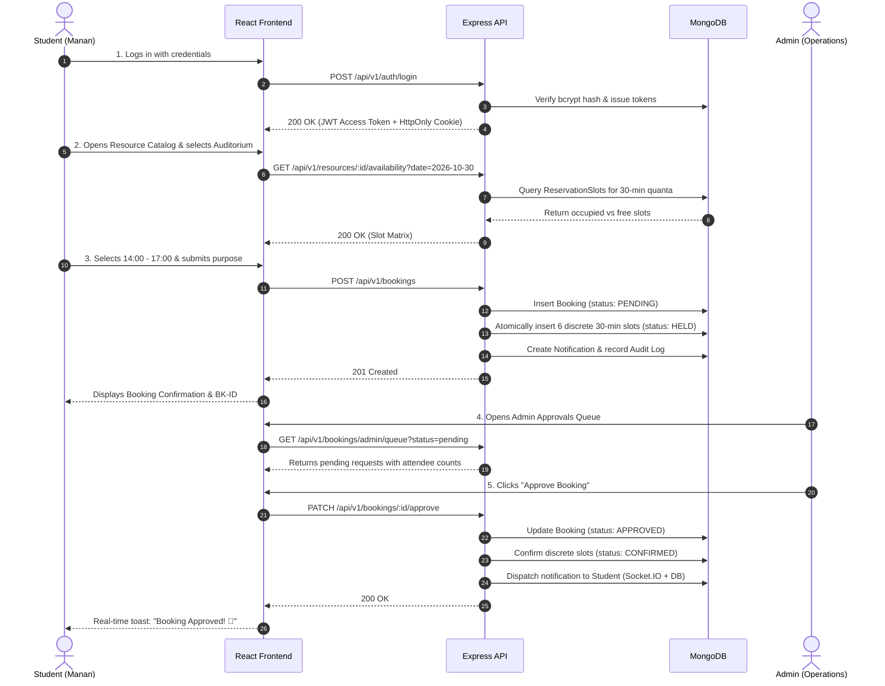

# CampusFlow — Project Overview & Problem Domain

## 1. Executive Summary & Purpose

**CampusFlow** is an enterprise-grade full-stack MERN (MongoDB, Express.js, React.js, Node.js) web application designed to digitize, streamline, and govern physical campus facilities and resource reservations across academic institutions.

In modern universities and colleges, shared facilities such as high-performance computing laboratories, science laboratories, seminar auditoriums, smart classrooms, executive boardrooms, and specialized audio-visual equipment represent heavy institutional capital investments. Despite their critical importance, the management of these spaces is frequently plagued by manual paper registers, informal chat messages, and fragmented departmental spreadsheets.

CampusFlow replaces this chaotic environment with a centralized, mathematical, and role-governed digital platform. It enforces hard conflict prevention, transparent administrative approval queues, scheduled maintenance blackout windows, and real-time event notifications.

---

## 2. Problem Statement: Traditional Resource Booking vs. CampusFlow

### 2.1 Problems in Traditional Manual Campus Resource Allocation

| Problem in Manual System | Institutional Impact | Real-World Campus Scenario |
|---|---|---|
| **Double Bookings & Collisions** | Two departments or faculty members schedule the same hall for the same time. | The IEEE Student Chapter and the Placement Cell both arrive at the 450-seat Central Auditorium at 10:00 AM on Monday, leading to confusion and delayed academic activities. |
| **Lack of Real-Time Visibility** | Students and faculty walk to physical offices or departmental noticeboards to verify room availability. | A research scholar spends two hours walking between buildings only to discover that the Advanced Robotics Lab is booked all afternoon. |
| **No Granular Role Authorization** | Undergraduates book sensitive, expensive research apparatus without faculty oversight. | High-power lasers or liquid helium cryogenic chambers are scheduled without certified supervisor oversight. |
| **Zero Auditability & Accountability** | When room assets are misplaced or equipment is left unlocked, paper sign-up sheets provide zero tamper-proof tracking. | An HDMI 4K laser projector kit goes missing; physical sign-out logs have missing signatures or illegible entries. |
| **Uncoordinated Maintenance** | Facilities management cleans air ducts or performs electrical rewiring without notifying scheduled events. | A midterm practical exam is disrupted halfway through because technicians cut laboratory power for scheduled maintenance. |

### 2.2 How CampusFlow Resolves These Challenges

```
Traditional Workflow:
Student -> Paper Form -> Department Head -> Dean's Office -> Key Dispatcher -> Frequent Conflicts

CampusFlow Digital Workflow:
User Browser -> Discrete Slot Check -> Atomic Reservation -> Admin Queue -> Real-Time Notification -> Immutable Audit
```

1. **Discrete Slot Time Quanta (Concurrency Protection)**: Every calendar reservation is sliced into discrete 30-minute normalized units (`09:00`, `09:30`, `10:00`). MongoDB enforces a **compound unique index** on `(resource, date, slotTime)`. Double-booking is rendered mathematically impossible at the database layer.
2. **Layered Role-Based Access Control (RBAC)**: Facilities specify explicit `allowedRoles` (e.g., Science Labs restricted to `['faculty', 'admin']`; Classrooms open to `['student', 'faculty', 'admin']`).
3. **Structured Approval Workflows**: Bookings enter a `pending` status where administrators review attendee numbers, purpose statements, and scheduling needs before issuing one-click approvals or structured rejections.
4. **Maintenance Blackouts with Automated Dispute Resolution**: Administrators can schedule maintenance windows. The system automatically identifies existing conflicting bookings, cancels them, releases their reservation slots, and dispatches real-time alerts to affected students.
5. **Tamper-Evident Security & Audit Trail**: Every status mutation, facility edit, role promotion, and login is recorded in an immutable `auditlogs` collection logging actor ID, action type, IP address, and timestamp.

---

## 3. Supported User Roles & Permissions Summary

CampusFlow implements three distinct user scopes defined in `backend/src/config/constants.js`:

```
+-----------------------------------------------------------------+
|                        CAMPUSFLOW ROLES                         |
+-----------------------------------------------------------------+
|  1. STUDENT    | Self-service browsing, requesting eligible     |
|                | labs/classrooms, viewing personal bookings,    |
|                | cancelling requests, reading notifications.     |
+----------------+------------------------------------------------+
|  2. FACULTY    | Priority access to advanced research labs,      |
|                | extended-duration reservations, conference     |
|                | suites, tracking departmental requests.         |
+----------------+------------------------------------------------+
|  3. ADMIN      | Full institutional governance: facility CRUD,  |
|                | approvals queue, user role management,         |
|                | scheduling maintenance, audit logs, CSV reports|
+-----------------------------------------------------------------+
```

---

## 4. Complete End-to-End User Journey

Consider a student (**Manan Sharma**) booking the **APJ Abdul Kalam Grand Auditorium** for an IEEE Hackathon:



---

## 5. Real Feature Implementation Status Matrix

This project audit conducted a line-by-line inspection of the source code and executed test suites. Features are categorized based on real evidence in the repository:

### 5.1 Fully Implemented & Automated-Tested Features
- **Health & Readiness Telemetry**: `GET /api/v1/health` monitors process uptime and MongoDB connection state (`1 = connected`). Tested in `backend/tests/api.test.js`.
- **Public Registration & Role Guard**: `POST /api/v1/auth/signup` registers students and faculty, blocks duplicate emails with `409 Conflict`, and forbids public registration as `admin` with `400 Bad Request`. Tested in `api.test.js`.
- **Credential Verification**: `POST /api/v1/auth/login` checks bcrypt password hash and emits generic `401 Unauthorized` on mismatch. Tested in `api.test.js`.
- **Token-Guarded Profile Retrieval**: `GET /api/v1/auth/me` verifies Bearer JWT and returns user details. Tested in `api.test.js`.
- **Resource Browsing & RBAC Permissions**: Public resource listing, student forbidden from creating resources (`403`), and admin facility creation verified. Tested in `api.test.js`.
- **Discrete 30-Minute Slot Allocations**: Slot reservation allocates discrete slices (`10:00`, `10:30`, `11:00`). Tested in `api.test.js`.
- **Overlapping Booking Rejection**: Overlapping time request rejected with `409 Conflict`. Tested in `api.test.js`.
- **Race Condition Concurrency Protection**: Simultaneous `Promise.all` test submitting identical bookings guarantees exactly one succeeds (`201`) and one fails (`409`). Tested in `api.test.js`.
- **Administrative Approval & Slot Confirmation**: `PATCH /api/v1/bookings/:id/approve` updates booking to `approved` and reservation slots to `confirmed`. Tested in `api.test.js`.
- **Requester Cancellation & Slot Release**: `PATCH /api/v1/bookings/:id/cancel` updates booking to `cancelled` and atomically deletes slot records. Tested in `api.test.js`.
- **Maintenance Conflict Resolution**: `POST /api/v1/maintenance` schedules blackout, auto-cancels existing conflicting bookings, and notifies users. Tested in `api.test.js`.
- **Analytics & Report Generation**: `GET /api/v1/analytics/dashboard` returns system KPIs; CSV exports allow admin access and block student access (`403`). Tested in `api.test.js`.
- **Frontend Core Components**: Modal dialogs, variant Badges, and Landing page verified in `frontend/src/__tests__/App.test.jsx`.

### 5.2 Implemented in Code (Functional Verification via Manual/E2E Execution)
- **Interactive OpenAPI / Swagger Documentation**: Embedded at `/api/docs` via `swagger-ui-express`.
- **Real-Time WebSockets**: Authenticated Socket.IO rooms (`user:<userId>` and `role:admin`) implemented in `backend/src/sockets/socketHandler.js` and `frontend/src/services/socket.js`.
- **Administrative User Governance**: Modifying user roles and deactivating user accounts in `backend/src/controllers/userController.js` and `frontend/src/pages/admin/AdminUsersPage.jsx`.
- **Immutable Audit Trail Filtering**: Querying audit logs by action type or model target in `AdminAuditLogsPage.jsx`.
- **CSV Browser Stream Downloads**: Generating client-side blobs for reservation ledgers and facility utilization in `AdminReportsPage.jsx`.

### 5.3 Partially Implemented or Fallback Mechanisms
- **SMTP Email Notifications**: `backend/src/services/emailService.js` contains a production nodemailer adapter. If SMTP environment variables are not populated, it executes a development fallback that logs email dispatches to the server console rather than sending actual emails.
- **Password Reset Flow**: `POST /api/v1/auth/forgot-password` and `POST /api/v1/auth/reset-password` are implemented in backend controllers and models (`PasswordResetToken.js`), and frontend pages exist (`ForgotPasswordPage.jsx`, `ResetPasswordPage.jsx`). However, end-to-end delivery depends on an active SMTP provider.

### 5.4 Planned or Future Scope (Not Implemented)
- **Physical QR Code Check-In**: Generating dynamic QR codes for door scanners or hardware access control.
- **Calendar Protocol Synchronization**: CalDAV, Google Calendar, or Microsoft Outlook `.ics` subscription feeds.
- **Recurring Booking Patterns**: Recurrence rules (e.g., "Every Tuesday for 14 weeks"). Currently, each reservation requires a discrete date.
- **Fine-Grained Sub-Resource Equipment Checkouts**: Reserving individual chairs or laptops inside a room rather than the entire room entity.

---

## 6. What Makes CampusFlow a True Full-Stack Web Application?

CampusFlow is not a static website or a front-end UI prototype with mock data. It is a genuine 3-tier architecture:

1. **Client Tier (Presentation)**: Built with **React 18** and **Vite**, using a component architecture, client-side routing (`react-router-dom`), context-driven state management (`AuthContext`, `ToastContext`, `NotificationContext`), and responsive Tailwind CSS styling.
2. **Server Tier (Application Logic & Gateway)**: Built with **Node.js** and **Express.js**, enforcing security headers (`helmet`), CORS whitelisting, anti-CSRF checks, rate limiters, token-based authentication (`jsonwebtoken`), schema validation (`zod`), REST routing, and real-time WebSockets (`socket.io`).
3. **Database Tier (Persistence & Constraints)**: Built with **MongoDB** and **Mongoose**, enforcing schema constraints, relational references, automated index creation, and unique compound constraints to prevent race conditions.
